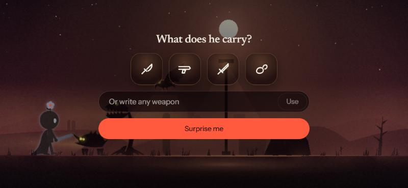
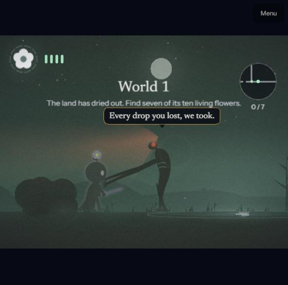
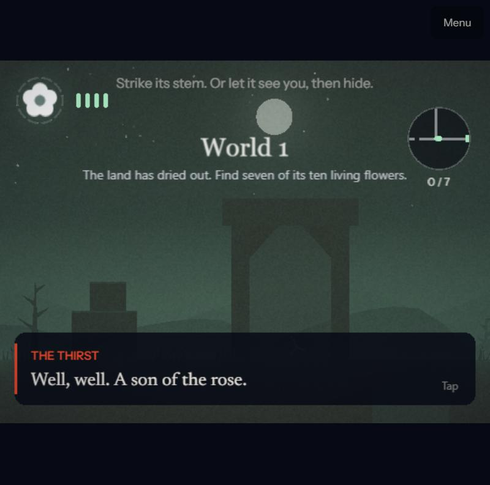
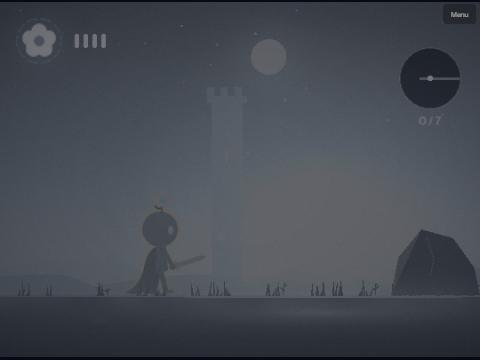
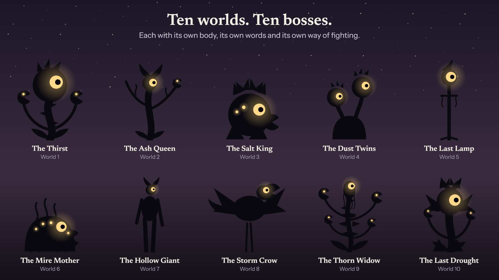
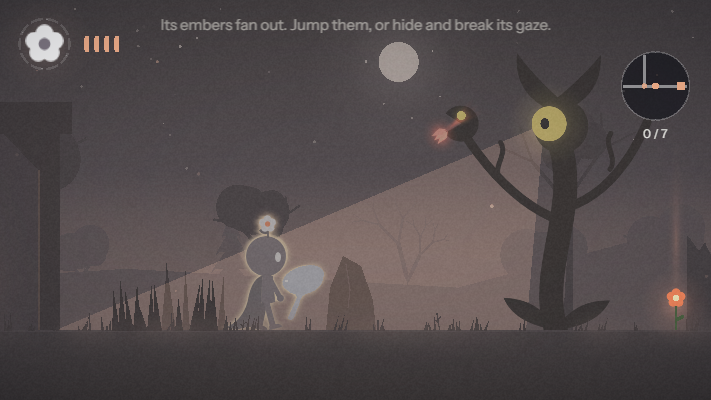
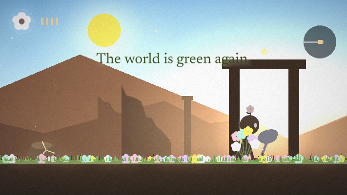
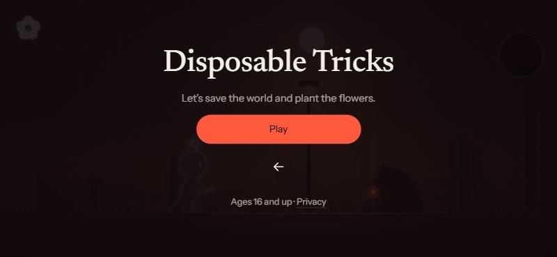
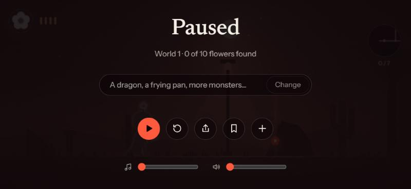
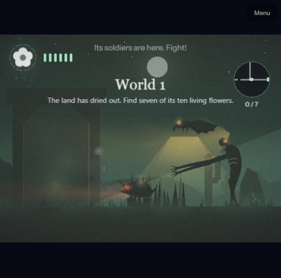

# Disposable Tricks

**A dark little world you change by writing to it.**

A small hero with a flower on his head crosses dried-out lands. Light gives him away, monsters hunt him, and the living flowers he finds bring the world back to life. Before you play, you choose what he carries, and you can write anything you like ("a bazooka", "zombies", "a dragon"). An AI turns your words into the game.

**▶ Play it on your phone, held sideways: [disposable-tricks.pages.dev](https://disposable-tricks.pages.dev)**

<table>
  <tr>
    <td></td>
    <td></td>
  </tr>
  <tr>
    <td></td>
    <td></td>
  </tr>
</table>



<table>
  <tr>
    <td></td>
    <td></td>
  </tr>
</table>

## The game

- **Your words make the game.** Pick one of four weapons, or write your own. Every game has all five of our monsters, and you can write in more. The AI builds what you wrote from our own art and rules, and checks its answer against your words. If the AI is unavailable, the game reads your words itself, so you always get something to play.
- **Stealth first, the sword second.** Light exposes you. Monsters become suspicious before they attack. Every attack is warned and can be avoided without a weapon: hide, lie flat, jump or step aside. Each attack also leaves an opening.
- **A story to finish.** Find seven of ten living flowers in each world, break stones, take detours through glowing gates, and plant the flowers at the end. Beat the tenth boss and the whole world turns green: the sun comes up and flowers open everywhere.
- **Ten worlds, each harder than the last,** from the Dry Desert to the Dry Heart, each with its own colours, scenery and monsters.
- **Ten bosses, ten characters.** Each has its own body, its own words and its own way of fighting: the Ash Queen fans embers, the Salt King rains salt, the Dust Twins vanish and rise in front of you, the Hollow Giant stamps waves you must jump, the Storm Crow blows you back. Each names the next as it falls.
- **Fall, and try that world again.** Losing every petal takes you back to the start of the world you were in, with the skills you had.
- **Calm music that follows you.** Made in code as you play: it darkens when a monster notices you and gains a bell note with every flower you find.
- **Made for phones:** touch controls, vibration on Android, add-to-home-screen. No sign-in, nothing collected, ages 16+.

## How it was made

Designed and directed by **Amin Ranjbar**; built with **Claude Code** as the AI engineer. Each step started with research, then a plan, then a measurement:

| Step | What changed | Measured |
|---|---|---|
| Characters | Silhouette research (Limbo, Inside, Hollow Knight) led to five monsters redrawn around one language of light | |
| Controls and feel | Strike on touch-down, flick to jump, dust and squash, forgiving ledges | Strike delay up to 200 ms → next frame |
| Difficulty | Bot players with human reaction times played 60 roads each | Skilled-bot finish rate 63% → 87% |
| AI reliability | An evaluation set of 57 written wishes, an answer checker and a fallback | 35 of 49 right → 57 of 57, none empty |
| Launch | One Cloudflare project for the game and the AI | Download 413 KB → 380 KB (gzip) |

The dated story is in [HISTORY.md](HISTORY.md), the decisions in [docs/design-decisions.md](docs/design-decisions.md), and the research behind each step in [docs/reports](docs/reports).

<table>
  <tr>
    <td></td>
    <td></td>
    <td></td>
  </tr>
</table>

## Built with

- **Game:** TypeScript, [Phaser 3](https://phaser.io), Vite. All art is drawn in code as silhouettes; all sound and music are made in code with the Web Audio API.
- **AI:** a small server that asks Groq first, then Cloudflare Workers AI, repairs and checks every answer, and limits calls to stay within free plans.
- **Hosting:** Cloudflare Pages, with the AI as a Pages Function on the same address.
- **Tests:** 350 Vitest tests, including bot playtests, every boss's moves, and the AI evaluation set.

## Run it on your computer

You need [Node.js](https://nodejs.org) 22 or later.

```bash
npm install
```

```bash
npm run dev
```

Then open http://localhost:5183. To try it on a phone on the same Wi-Fi, run `npm run dev:phone` and open the "Network" address it prints. On Windows you can also double-click `scripts/start-game.bat`.

The game works without any AI keys: it then reads written wishes itself. To use the real AI locally, copy `server/.env.example` to `server/.env` and add your keys ([server/README.md](server/README.md)).

| Command | What it does |
|---|---|
| `npm test` | Runs all tests |
| `npm run build` | Type-checks and builds the site into `dist/` |
| `npm run deploy` | Builds and publishes to Cloudflare Pages ([docs/deploy.md](docs/deploy.md)) |

## What is where

| Folder | Contents |
|---|---|
| `src/game` | The game: hero, monsters, worlds, light, story and dialogue |
| `src/ui` | The menus around the game |
| `src/ai` | Turning written wishes into the game, with the checker and the fallback |
| `src/core` | Controls, music, sound and other shared pieces |
| `server` | The AI server, which also runs as the Cloudflare function in `functions/` |
| `tests` | Tests, including `tests/sim`, the bot players |
| `docs` | Design decisions, progress, reports, research and deployment |

## Credits

Concept, design and direction: Amin Ranjbar. Code: written with Claude Code (Anthropic) under Amin's direction. Fonts: Newsreader and Instrument Sans (SIL Open Font License).

© 2026 Amin Ranjbar. All rights reserved.
